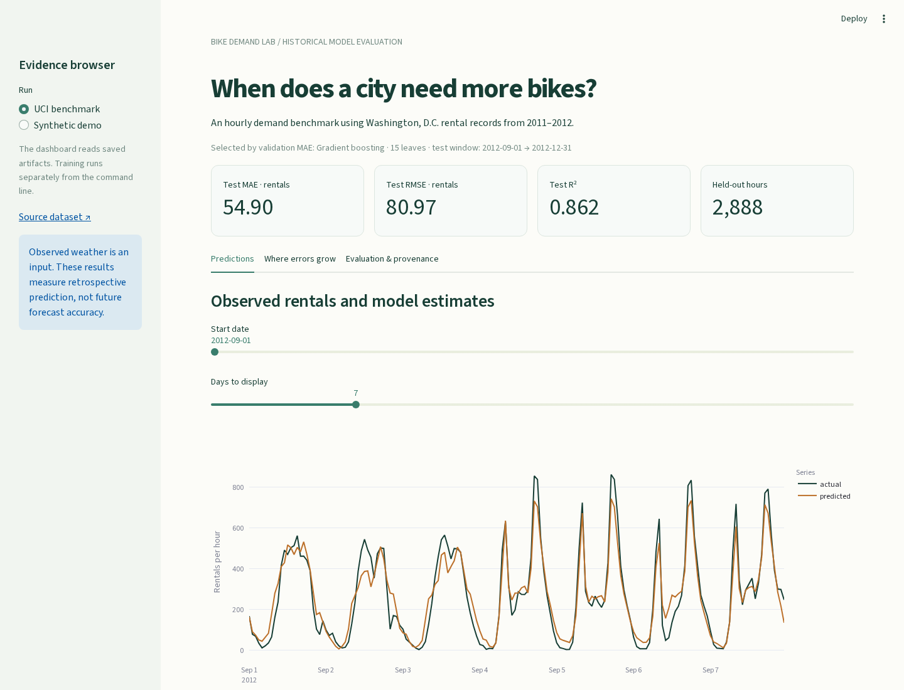

# Bike Demand Lab

An hourly bike-rental prediction project with a small dashboard for inspecting predictions, model comparisons and errors. It uses the UCI Bike Sharing dataset from Washington, D.C. The point is to make the evaluation easy to check, including the choices that can accidentally make a model look better than it is.



## Run it

Python 3.11–3.13:

```sh
python -m venv .venv
# macOS/Linux: source .venv/bin/activate
# Windows: .venv\Scripts\activate
python -m pip install -e ".[dev]"
bike-demand fetch
bike-demand train
streamlit run app.py
```

The dashboard can open the committed benchmark artifacts immediately, without downloading data, loading a model or retraining. `bike-demand demo` runs an offline synthetic smoke check, saved separately under `artifacts/demo/`. Synthetic scores are labelled in the dashboard.

## Measured result

The official 17,379-row hourly dataset was downloaded and checked against recorded SHA-256 fingerprints. Training ends before May 2012; validation covers May–August; the 2,888 held-out observations cover September–December 2012. The gradient-boosting configuration was chosen by validation MAE, before test evaluation.

| Model | Test MAE | Test RMSE | Test R² |
|---|---:|---:|---:|
| Training mean | 170.509 | 226.027 | -0.078 |
| Hour × workday mean | 94.780 | 138.527 | 0.595 |
| Ridge | 97.530 | 132.584 | 0.629 |
| Histogram gradient boosting | 54.896 | 80.970 | 0.862 |

A second independent run produced a byte-identical manifest and all four diagnostic/prediction CSVs under the recorded versions.

Errors are hourly rental counts. These are **retrospective predictions using observed weather**, not evidence of future forecast performance. One temporal holdout does not establish generalization to another city or period.

## What keeps the comparison honest

- `casual` and `registered` sum to the target. Neither enters the explicit feature allowlist. Record IDs are excluded too.
- Dates are split chronologically. Imputation, scaling and categorical encoding fit inside each training pipeline.
- A finite grid is compared on validation MAE. Each family's chosen configuration is refitted on training + validation, then evaluated on the untouched final dates.
- The 165 missing source hours remain missing; they are not invented as zero demand.
- Saved evidence includes all validation configurations, test predictions, errors by hour/season, data fingerprints, library versions and a [model card](artifacts/MODEL_CARD.md).
- Permutation importance is a post-evaluation diagnostic. Correlated inputs limit its interpretation; it is not a causal analysis.

## Inspect or reproduce

```sh
python -m pytest -q
ruff check src tests app.py
bike-demand train --output artifacts/reproduction
```

`src/bike_demand/data.py` owns acquisition and splits; `models.py` owns features and pipelines; `evaluation.py` writes evidence; `app.py` only reads it. Model files are ignored and created locally. Load only model files you generated or trust: joblib uses Python serialization.

The download is pinned to exact official bytes. A changed upstream archive fails closed until provenance is reviewed. CI runs the offline tests and synthetic pipeline; it does not require network data access.

## Data and license

Code: MIT. Data: UCI Bike Sharing, Hadi Fanaee-T (2013), [DOI 10.24432/C5W894](https://doi.org/10.24432/C5W894), CC BY 4.0. See [data provenance](data/PROVENANCE.md). This is a new portfolio implementation; no published paper or external validation is claimed.
